# ClearDrop system design

## 1. Architecture overview

### Product and operating assumptions

- The application is a small, local-first PHP 8 + SQLite system. This keeps the current ClearDrop demo and its customer ordering flow while adding a normalized manufacturing catalog.
- Phase 1 runs at one workshop. The schema includes locations so later inventory can span a workshop, storage, and partner drop-off points.
- Expected monthly volume is not set. Reorder thresholds start as explicit per-component values; seasonality and monthly demand forecasts are deferred to inventory planning.
- Online marketplace orders are recorded manually or imported from CSV; there are no live marketplace integrations. SMS/email reminders are not enabled.
- The household filter's PHP 3,500 selling price, PHP 2,750 production cost, PHP 1,450 material cost, and PHP 500 cartridge-set price are all planning estimates. The main-unit cost breakdown is also estimated: materials PHP 1,450, labor PHP 450, manufacturing PHP 300, packaging PHP 150, transportation PHP 150, and other PHP 250. The BOM quantities, cartridge composition, and component costs must be checked against a physical prototype and supplier quotes.
- The first product BOM assumes two 20 L buckets, two ceramic candles, and a carbon stage. The replacement cartridge BOM assumes two ceramic candles plus one carbon stage. Sand/gravel quantities and the base stand remain prototype assumptions.
- The product concept is not a water-safety certification. Public-facing instructions must retain the water-safety notice and avoid claiming that untreated or flood-contaminated water is safe to drink.

### Runtime and boundaries

```text
Browser (HTML/CSS/JavaScript)
  ├── auth.php          session login, role resolution, logout
  ├── inventory-api.php current demo material-ordering endpoints
  └── catalog-api.php   Phase 1 products, components, BOM versions, demo users
          │
          └── PDO SQLite (cleardrop.sqlite; persistent Docker volume when containerized)
```

PHP creates and migrates the SQLite schema idempotently through `database.php`. Prepared PDO statements are used for user data. Session cookies are HttpOnly, SameSite=Lax, and Secure when HTTPS is enabled. Passwords are stored using `password_hash`; roles are resolved from database relations, not chosen by the login form. Product, component, BOM, and user administration is restricted to the Admin / Owner role. Catalog changes and user changes are written to `audit_logs`.

SQLite stores money as integer PHP cents; API field names end in `_cents`. No monetary arithmetic uses floating-point values in the PHP backend. BOM quantities use integer thousandths (`quantity_milli`) so fractional kilogram quantities are repeatable and auditable.

The present action-based PHP endpoints are suitable for the local demo. The versioned REST paths in [api.md](./api.md) are the intended full-system contract; modules not in Phase 1 are documented design, not implemented routes.

### Roles and access

| Role key | Responsibilities | Phase 1 access |
|---|---|---|
| `admin` | Owner, pricing, accounts, configuration | Read catalog; create/edit/deactivate products and components; create BOM versions; manage demo users |
| `inventory` | Stock, suppliers, receiving, QC | Read catalog; operational stock controls are Phase 2 |
| `production` | Assembly and defects | Read catalog and current BOM; production controls are Phase 3 |
| `sales` | Quotations, orders, payment, delivery | Read catalog; order workflow is a later phase |
| `partner` | LGU/NGO/church and household accounts | Read catalog; partner portal is a later phase |
| `distributor` | Field distributions and demo sessions | Read catalog; field workflows are Phase 5 |
| `customer` | Classroom ordering demo | Read catalog and use the existing materials-ordering demo |

### Phase boundaries

1. **Phase 1 — implemented here:** PHP/SQLite setup, database-backed login, roles, product and component catalog, versioned BOMs, estimate labels, admin account controls, role changes, and audit records for sensitive catalog/account edits.
2. **Phase 2 — planned:** append-only stock ledger, locations, lots/QC, reorder and seasonal buffers, suppliers, purchase orders, receiving, counts, and alerts. Existing demo ordering stock is not yet the manufacturing ledger.
3. **Phase 3 — planned:** production orders, BOM availability/shortfall checks, QC-qualified FIFO component consumption, atomic production output, defects, and unique unit serials.
4. **Phase 4 — planned:** retail/bulk/distribution/warranty order types, reservations, quotations, partial deliveries, payments/installments, documents, and idempotency keys.
5. **Phase 5 — planned:** distribution traceability, barangay/community records, warranty claims, replacement parts, and configurable cartridge follow-up.
6. **Phase 6 — planned:** impact/finance reports, exports, live stock/order events, broader automated tests, and deployment hardening.

## 2. Database schema

### Relationships

The ER diagram shows the planned normalized target schema. Solid Phase 1 tables are implemented now; tables labeled by later modules are design contracts to be introduced with their phase.

```mermaid
erDiagram
    ROLES ||--o{ USERS : assigns
    USERS ||--o{ AUDIT_LOGS : performs
    USERS ||--o{ BOM_VERSIONS : authors
    USERS ||--o{ STOCK_MOVEMENTS : records
    USERS ||--o{ PRODUCTION_ORDERS : operates
    USERS ||--o{ ORDERS : places
    USERS ||--o{ SURVEY_ENTRIES : records
    PRODUCTS ||--o{ BOM_VERSIONS : has
    BOM_VERSIONS ||--|{ BOM_ITEMS : contains
    COMPONENTS ||--o{ BOM_ITEMS : required_by
    LOCATIONS ||--o{ INVENTORY_LEVELS : stores
    COMPONENTS ||--o{ INVENTORY_LEVELS : counted_at
    PRODUCTS ||--o{ INVENTORY_LEVELS : finished_stock_at
    COMPONENTS ||--o{ STOCK_LOTS : received_as
    SUPPLIERS ||--o{ STOCK_LOTS : supplies
    LOCATIONS ||--o{ STOCK_LOTS : holds
    STOCK_LOTS ||--o{ STOCK_MOVEMENTS : traced_in
    COMPONENTS ||--o{ STOCK_MOVEMENTS : moves
    PRODUCTS ||--o{ STOCK_MOVEMENTS : moves
    SUPPLIERS ||--o{ PURCHASE_ORDERS : receives_orders
    PURCHASE_ORDERS ||--|{ PURCHASE_ORDER_ITEMS : includes
    COMPONENTS ||--o{ PURCHASE_ORDER_ITEMS : purchased_as
    PURCHASE_ORDERS ||--o{ STOCK_LOTS : received_into
    PRODUCTS ||--o{ PRODUCTION_ORDERS : produces
    BOM_VERSIONS ||--o{ PRODUCTION_ORDERS : specifies
    PRODUCTION_ORDERS ||--o{ UNIT_SERIALS : yields
    PRODUCTS ||--o{ UNIT_SERIALS : serializes
    CUSTOMERS ||--o{ ORDERS : owns
    PARTNERS ||--o{ ORDERS : places
    BARANGAYS ||--o{ ORDERS : serves
    ORDERS ||--|{ ORDER_ITEMS : contains
    PRODUCTS ||--o{ ORDER_ITEMS : sells
    ORDERS ||--o{ DELIVERIES : fulfilled_by
    DELIVERIES ||--o{ UNIT_SERIALS : assigns
    ORDERS ||--o{ PAYMENTS : paid_by
    ORDERS ||--o{ INSTALLMENT_SCHEDULES : finances
    UNIT_SERIALS ||--o{ WARRANTY_CLAIMS : covered_by
    UNIT_SERIALS ||--o{ CARTRIDGE_FOLLOWUPS : tracks
    CUSTOMERS ||--o{ SURVEY_ENTRIES : surveys
    BARANGAYS ||--o{ SURVEY_ENTRIES : locates
    ORDERS ||--o{ IDEMPOTENCY_KEYS : deduplicates

    ROLES {
      int id PK
      string role_key UK
      string name
    }
    USERS {
      int id PK
      string username UK
      string password_hash
      int role_id FK
      bool active
      datetime deleted_at
    }
    PRODUCTS {
      int id PK
      string sku UK
      string product_type
      string name
      int sale_price_cents
      int estimated_unit_cost_cents
      bool cost_is_estimate
      bool active
      datetime deleted_at
    }
    COMPONENTS {
      int id PK
      string code UK
      string name
      string unit
      int estimated_unit_cost_cents
      int reorder_level
      bool active
      datetime deleted_at
    }
    BOM_VERSIONS {
      int id PK
      int product_id FK
      int version
      int created_by FK
      datetime created_at
      string notes
    }
    BOM_ITEMS {
      int bom_version_id PK,FK
      int component_id PK,FK
      int quantity_milli
    }
    LOCATIONS {
      int id PK
      string code UK
      string name
      string location_type
      bool active
    }
    INVENTORY_LEVELS {
      int id PK
      int location_id FK
      int component_id FK
      int product_id FK
      int on_hand
      int reserved
      int reorder_level
    }
    STOCK_LOTS {
      int id PK
      int component_id FK
      int supplier_id FK
      int purchase_order_id FK
      int location_id FK
      string lot_number
      string qc_status
      string lab_test_reference
      datetime received_at
    }
    STOCK_MOVEMENTS {
      int id PK
      int component_id FK
      int product_id FK
      int lot_id FK
      int location_id FK
      int quantity_delta
      string movement_type
      string reference_id
      int user_id FK
      datetime created_at
    }
    SUPPLIERS {
      int id PK
      string code UK
      string name
      int lead_time_days
      bool active
    }
    PURCHASE_ORDERS {
      int id PK
      string order_number UK
      int supplier_id FK
      string status
      string currency
      datetime ordered_at
    }
    PURCHASE_ORDER_ITEMS {
      int id PK
      int purchase_order_id FK
      int component_id FK
      int quantity_ordered
      int quantity_received
      int unit_cost_cents
    }
    PRODUCTION_ORDERS {
      int id PK
      string order_number UK
      int product_id FK
      int bom_version_id FK
      int quantity_planned
      int quantity_good
      int quantity_scrapped
      string status
      int actual_labor_cost_cents
      int actual_overhead_cost_cents
    }
    UNIT_SERIALS {
      int id PK
      string serial_number UK
      int product_id FK
      int production_order_id FK
      int delivery_id FK
      int warranty_months
      datetime cartridge_due_at
    }
    CUSTOMERS {
      int id PK
      int user_id FK
      string customer_type
      string name
      string contact
    }
    PARTNERS {
      int id PK
      int customer_id FK
      string partner_type
      int barangay_id FK
    }
    BARANGAYS {
      int id PK
      string name
      string city
      string province
      bool sample_data
    }
    ORDERS {
      int id PK
      string order_number UK
      int customer_id FK
      int partner_id FK
      int barangay_id FK
      string order_type
      string channel
      string status
      string payment_status
      int total_cents
      datetime created_at
    }
    ORDER_ITEMS {
      int id PK
      int order_id FK
      int product_id FK
      string sku_snapshot
      string name_snapshot
      int quantity
      int unit_price_cents
      int unit_cost_cents
      int delivered_quantity
    }
    DELIVERIES {
      int id PK
      int order_id FK
      string delivery_number UK
      string status
      datetime delivered_at
    }
    PAYMENTS {
      int id PK
      int order_id FK
      string method
      string status
      int amount_cents
      string reference
      datetime paid_at
    }
    INSTALLMENT_SCHEDULES {
      int id PK
      int order_id FK
      int sequence
      int amount_due_cents
      datetime due_at
      datetime paid_at
    }
    WARRANTY_CLAIMS {
      int id PK
      int unit_serial_id FK
      string claim_number UK
      string status
      string resolution
      datetime created_at
    }
    CARTRIDGE_FOLLOWUPS {
      int id PK
      int unit_serial_id FK
      datetime due_at
      datetime contacted_at
      int replacement_order_id FK
    }
    SURVEY_ENTRIES {
      int id PK
      int customer_id FK
      int barangay_id FK
      int liters_per_month
      int spending_before_cents
      int spending_after_cents
      string self_reported_health_note
      bool survey_based
    }
    AUDIT_LOGS {
      int id PK
      int actor_user_id FK
      string entity_type
      int entity_id
      string action
      string metadata_json
      datetime created_at
    }
    IDEMPOTENCY_KEYS {
      string key PK
      int order_id FK
      datetime created_at
    }
```



### Database constraints and invariants

- Unique indexes: role key, username, SKU/component code, product+version, unit serial, order/PO/delivery/claim number, and idempotency key.
- Foreign keys are enabled for every SQLite connection. Quantities and stock are integer types with nonnegative checks; the stock ledger stores signed deltas while `inventory_levels` remains nonnegative.
- Money is an integer number of PHP cents in the SQLite implementation. If ported to a decimal-capable database, use fixed-precision decimal values and never binary floats.
- BOM item quantities are positive integer thousandths of the component's declared unit; a BOM version is immutable after creation.
- Stock-lot QC values are `PENDING`, `PASSED`, or `FAILED`; only `PASSED` stock can be consumed. FIFO means earliest eligible receipt first.
- A product/component with historical use is deactivated/soft-deleted, not physically removed.
- Stock movements are append-only and are the source of inventory changes. `inventory_levels` is a transactionally maintained projection. Each production completion, order reservation/release, delivery, return, and adjustment must update its ledger and projection atomically.
- Order confirmation reserves finished stock; cancellation/expiry releases the reservation; delivery/distribution consumes reserved stock. All order/production stock validation and writes occur within one transaction.
- Snapshot name, SKU, unit price, cost, and applicable tax on order lines. Idempotency keys prevent duplicate order creation. Installment amounts must sum to the order total.
- Survey figures are explicitly survey-based; reports must not auto-claim health improvements or savings.

### Phase 1 SQLite tables

Implemented now: `roles`, `users`, `products`, `components`, `bom_versions`, `bom_items`, and `audit_logs`, plus the existing demo's `orders`, `order_items`, and `order_reservations`. Existing `materials` data is migrated in-place by renaming its table to `components`. The `components.orderable` flag keeps raw production inputs separate from the public ordering list. The future ledger, supplier, lot, production, delivery, finance, warranty, and impact tables are added with their owning phase.

## 3. API contract and endpoint inventory

The canonical complete-system API is versioned at `/api/v1`. JSON errors use:

```json
{
  "error": {
    "code": "validation_error",
    "message": "The request is invalid.",
    "details": [{"field": "sku", "message": "Already in use."}]
  }
}
```

List endpoints accept `page` and `pageSize` (default 1 and 25, maximum 100) and return `data` plus `pagination`. Money uses integer PHP cents; write actions require an authenticated role. The Phase 1 local adapter currently uses the PHP actions listed below; canonical route conversion will happen as later modules are implemented.

| Module | Method and canonical route | Access | Phase |
|---|---|---|---|
| Auth | `POST /auth/login`, `POST /auth/logout`, `GET /auth/me` | Public / signed-in | 1 (session adapter) |
| Users/roles | `GET /users`, `POST /users`, `PATCH /users/{id}`, `GET /roles` | Admin | 1 (demo accounts; create/deactivate) |
| Catalog | `GET /products`, `POST /products`, `GET /products/{id}`, `PATCH /products/{id}` | Read signed-in; write Admin | 1 |
| Components | `GET /components`, `POST /components`, `GET /components/{id}`, `PATCH /components/{id}` | Read signed-in; write Admin | 1 |
| BOM | `GET /products/{id}/bom`, `POST /products/{id}/bom-versions` | Read signed-in; write Admin | 1 |
| Inventory | `GET /inventory/levels`, `GET /inventory/movements`, `GET /inventory/production-capacity`, `POST /inventory/adjustments`, `POST /inventory/counts` | Inventory / Admin | 2 |
| Lots/QC | `GET /lots`, `POST /lots`, `PATCH /lots/{id}/qc` | Inventory / Admin | 2 |
| Suppliers/POs | `GET /suppliers`, `POST /suppliers`, `GET /purchase-orders`, `POST /purchase-orders`, `POST /purchase-orders/{id}/receipts` | Inventory / Admin | 2 |
| Production | `GET /production-orders`, `POST /production-orders`, `POST /production-orders/{id}/complete` | Production / Admin | 3 |
| Serial units | `GET /units`, `GET /units/{serial}`, `POST /production-orders/{id}/serials` | Production / Sales / Admin | 3 |
| Quotations | `GET /quotations`, `POST /quotations`, `POST /quotations/{id}/confirm` | Sales / Admin | 4 |
| Orders | `GET /orders`, `POST /orders`, `GET /orders/{id}`, `PATCH /orders/{id}/status`, `POST /orders/{id}/cancel` | Sales / Admin; partner-scoped | 4 |
| Deliveries | `GET /orders/{id}/deliveries`, `POST /orders/{id}/deliveries` | Sales / Admin | 4 |
| Payments | `GET /orders/{id}/payments`, `POST /orders/{id}/payments`, `POST /orders/{id}/installments` | Sales / Admin | 4 |
| Documents | `GET /orders/{id}/documents/{quotation\|invoice\|receipt\|delivery}` | Sales / partner-scoped | 4 |
| Distributions | `GET /distributions`, `POST /distributions`, `POST /demo-sessions` | Distributor / Admin | 5 |
| Warranty | `GET /warranty-claims`, `POST /warranty-claims`, `PATCH /warranty-claims/{id}` | Sales / Admin | 5 |
| Cartridge follow-up | `GET /cartridge-followups`, `PATCH /units/{serial}/cartridge-due-date` | Sales / Admin | 5 |
| Public unit lookup | `GET /public/units/{serial}` | Public, limited fields | 5 |
| Reports/impact | `GET /reports/stock`, `/reports/sales`, `/reports/finance`, `/reports/impact`, `POST /surveys` | Admin; scoped distributor survey entry | 6 |
| Exports/events | `GET /exports/{report}.csv`, `GET /events` (SSE) | Role-scoped | 6 |

#### Phase 1 adapter endpoints in this repository

- `auth.php`: `GET ?action=status`; `POST {"action":"login","username":"...","password":"..."}`; `POST {"action":"logout"}`. Login response contains `authenticated`, `username`, `displayName`, and the resolved `role`.
- `catalog-api.php`: authenticated `GET ?action=catalog` returns `{products, components}`; inactive records are hidden from non-admin roles. Admin `GET ?action=users` returns `{users}`. Admin POST actions are `save_product`, `save_component`, `save_bom`, `create_user`, `update_user_role`, and `deactivate_user`. All edits are validated; BOM edits create a new version.
- `inventory-api.php`: current demo `GET ?action=dashboard`; POST actions `cart_add`, `cart_remove`, `restock`, `checkout`, and `order_status`. This remains the legacy ordering demonstration and is not yet the production stock ledger.

Example BOM version request:

```json
{
  "action": "save_bom",
  "productId": 1,
  "notes": "Prototype revision: validate media weights",
  "items": [
    {"componentId": 5, "quantityMilli": 2000},
    {"componentId": 4, "quantityMilli": 1000}
  ]
}
```

The response is `201` with a new `version` and `productId`. Invalid units/quantities, duplicate components, inactive components, or non-admin writes are rejected without creating a partial BOM.

## 4. Repository and folder structure

```text
.
├── lost-and-found.html       Existing browser application and ordering dashboard
├── styles.css                Shared responsive styling
├── script.js                 Authentication and current order-demo UI
├── catalog.js                Phase 1 catalog, BOM, and user-management UI
├── auth.php                  Database-backed session authentication
├── catalog-api.php           Phase 1 catalog and BOM API
├── inventory-api.php         Existing material-order demo API
├── database.php              SQLite setup, idempotent seed, migration, audit helper
├── Dockerfile                PHP + PDO SQLite image
├── docker-compose.yml        Local persistent-volume deployment
├── .env.example              Local port configuration example
├── docs/
│   ├── system-design.md      Architecture, normalized schema, ERD, phase boundaries
│   └── api.md                API contracts and request/response examples
├── tests/
│   └── phase1-catalog.php    Seed/BOM/auth-hash invariant checks
└── DemoLogin.java            Standalone classroom login example (not web auth)
```

Phase 1 keeps the current root layout so the existing HTML prototype remains easy to run. Future services can be separated by module when their phase is implemented; there is no empty scaffolding for unimplemented modules.

## 5. Phase 1 implementation and verification

The PHP application initializes its SQLite schema and estimate-labeled seed data on the first API request. Seeded demo users are hashed in the database and not overwritten on subsequent requests. Admin edits are audited. BOM versions and their component rows are immutable; saving a changed BOM appends the next version.

Run the Phase 1 implementation using the instructions in the root [README](../README.md). Costs, quantities, names, suppliers, and impact figures are sample estimates only. Do not use the demo passwords, sample stock, or concept filter as production-ready operations or drinking-water-safety claims.
